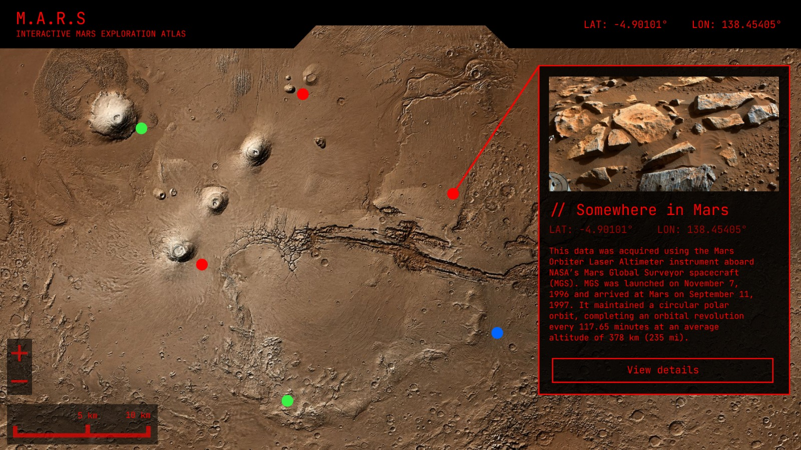

## what the hell is this?

A web-based interactive Mars exploration map that is designed to help future astronauts understand and navigate the Martian surface after landing. Think of it as Google Maps for Mars.

The application combines scientific data from multiple NASA missions into one interactive map, allowing users to explore Mars, discover geographical landmarks, access scientific information, and identify potential exploration destinations.

Instead of simply displaying a map, it tells astronauts what is around them, what makes each location scientifically interesting, and what they should know before exploring it.

Demo: https://martian-map-eight.vercel.app/

## Tech stack used

- Next.js
- Tailwind.css
- Typescript
- Openlayers WMTS
- Proj4js
- lucide-react
- Turf.js
- GeoJSON
- Zod

## NASA data usage

- Mars Trek Map Service: https://trek.nasa.gov/tiles/apidoc/trekAPI.html?body=mars
  - MRO HiRISE, Jezero Mosaic, Controlled
  - MRO HiRISE, Mosaic Jezero NE Syrtis Midway
  - MRO CTX, Jezero Mosaic, Controlled
  - MRO CTX, Jezero Mosaic, Preliminary
- Perseverance's traverse path at Jezero Crater: https://science.nasa.gov/mission/mars-2020-perseverance/location-map/

## TO DO

## Essential features

- [x] interactive map, panning, coords, and zooming feature
- [x] premade landmark and checkpoints
- [x] survival guidebook
- [x] multiple layers (CTX, Topography, etc)
- [x] clickable landmarks, which opens a popup and displays informations
- [x] Rover traverse path?
- [x] Distance calculator
- [ ] Add estimated travel time and food consumption for distance calculator
- [ ] add more map layers

## Would be nice to have

- [ ] AI chatbot
- [ ] All landmarks on global mars
- [ ] Add feature that allows user to add their own checkpoint/landmark

## Running Locally

```bash
# clone repo
git clone https://github.com/DevPadd/martian-map.git

# move to project directory
cd martian-map

# install dependencies
bun install
# or
npm install

# run development
npm run dev
# or
bun run dev
```

Open [http://localhost:3000](http://localhost:3000) with your browser to see the result.
